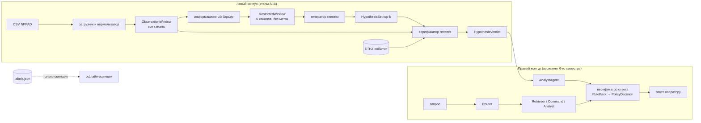
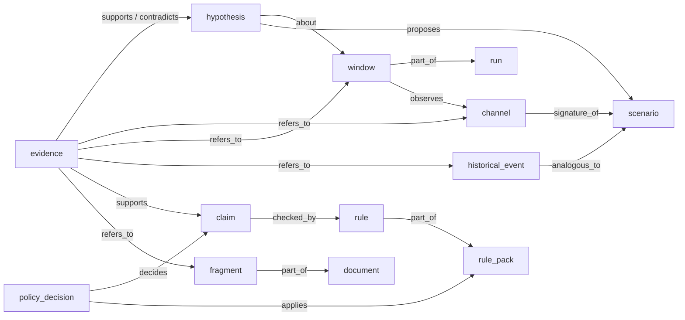

# Этап A. Модель данных и методы

Календарный этап 2 практики. Отчётность — «описание разработанной модели данных и методов». Срок по дорожной карте — 31.10.2026.

## 1. Назначение

Этап A закладывает основу для двух контуров дипломной системы:

- **левый контур (новый):** окно наблюдений NPPAD → информационный барьер → генератор гипотез → верификатор гипотез с аналогами из базы событий;
- **правый контур (ассистент 6-го семестра):** Router → Retriever | Command | Analyst, к которому добавляется верификатор ответа.

Оба контура говорят на одном языке — едином наборе контрактов данных и семантической модели. Инварианты документа «Upgrade to Guided Operations» сохраняются: система только читает данные, ничем не управляет, ничего не исполняет сама и не выдаёт рекомендаций действий.

## 2. Исходные данные

Подробно — в [datasets.md](datasets.md). Кратко: NPPAD (PCTRAN, PWR), 18 классов, 1217 прогонов, 96 каналов + время, шаг 10 с. Для обучения и benchmark взяты 12 классов с ≥ 99 прогонами разной тяжести; шесть однопрогонных классов используются как пробы вне распределения (D-004).

## 3. Реестр каналов

Файл `config/channels.toml` (сгенерирован из таблицы параметров README, схема 1.0.0). Для каждого канала хранятся:

| Поле | Смысл |
|---|---|
| `name` | каноническое имя, как в CSV (P, TAVG, …) |
| `readme_id` | номер в таблице README |
| `label`, `unit` | описание и единица измерения |
| `subsystem` | подсистема: primary, pressurizer, secondary, eccs, core, fuel, containment, radiation, severe_accident, break |
| `label_proxy` | величина описывает саму неисправность и кодирует метку (D-007) |

Распределение по подсистемам: первый контур — 19, второй контур — 15, радиационный контроль — 13, активная зона — 10, топливо — 7, оболочка — 7, САОЗ — 6, тяжёлая авария — 6, КД — 5, параметры течи (label_proxy) — 8.

**Разрешённые каналы генератора** (D-006) — по одному на каждую критическую функцию безопасности: PWNT, TAVG, PSGA, P, PRB, LVPZ. Набор задаётся в `config/diagnostics.toml`. При загрузке конфигурации проверяется, что каналы существуют, не повторяются и не являются label_proxy.

## 4. Конвейер подготовки данных

Команда: `uv run python scripts/load_nppad.py` (≈ 15 с на 1217 прогонов).

1. **Чтение** CSV каждого прогона (`read_raw_run`). Столбцы сопоставляются с реестром по имени, порядок приводится к реестру. Строки сортируются по времени (авторы NPPAD отмечают, что в части исходных баз порядок нарушен). Отсутствующий канал, неожиданный столбец или нечисловое значение — ошибка.
2. **Проверка сетки времени:** все шаги равны 10 с, иначе прогон попадает в список замечаний манифеста. На текущей версии замечаний нет.
3. **Идентификаторы:** непрозрачный `run_id` (SHA-256 от пути, D-012).
4. **Метки:** сценарий, тяжесть, номер неисправности PCTRAN и исходный путь записываются в отдельный `labels.json` (`LabelStore`). Тяжесть берётся из Transient Report (D-013).
5. **Разбиение** по прогонам 60/20/20, стратифицированное по сценарию, seed 42 (D-011).
6. **Нормализация** z-score: среднее и σ считаются только по строкам train-прогонов. Постоянные на train каналы получают σ = 1.
7. **Сохранение:** `runs.npz` (данные в физических единицах, время, смещения прогонов, id), `manifest.json`, `labels.json`.

Манифест фиксирует всё, что нужно для воспроизводимости (требование 13): коммит источника, версию и хэш конфигурации, версию схемы каналов, порядок каналов, параметры нормализации, состав разбиения, статистику и отброшенные столбцы.

## 5. Окна наблюдений

`NPPADDataset.windows(run_id)` нарезает прогон на окна длиной 12 точек (120 с) со сдвигом 6 точек (60 с), D-008. Окно (`ObservationWindow`) содержит нормализованные значения и значения в физических единицах по всем 96 каналам, непрозрачный `window_id`, `run_id` и время начала и конца. Окна не материализуются на диске, а строятся детерминированно из `runs.npz`.

Итого 80 371 окно; распределение по классам и выборкам — в [datasets.md](datasets.md).

## 6. Информационный барьер

Требование 5: генератор не видит скрытых данных и ground truth. Барьер реализован на трёх уровнях.

| Уровень | Механизм | Проверка |
|---|---|---|
| Тип данных | генератор принимает только `RestrictedWindow` с полями `window_id`, `channels`, `values`; полей run_id, времени, метки в типе нет | `test_restricted_window_type_has_no_label_fields` |
| Проекция | `InformationBarrier.restrict()` оставляет только разрешённые каналы из конфигурации; label_proxy запрещены при загрузке конфигурации | `test_barrier_output_contains_only_allowed_channels`, `test_config_rejects_label_proxy_channel` |
| Идентификаторы и метки | id — хэши без имени сценария; метки в отдельном файле; модули рабочего пути генератора не импортируют `labels.py` (статическая проверка импортов) | `test_window_id_does_not_leak_scenario`, `test_generator_path_does_not_import_labels`, `test_barrier_on_real_nppad_sample` |

## 7. Семантическая модель

Граф знаний (`atomic/knowledge/schema.py`, D-009). У каждого узла есть идентификатор, тип и происхождение (`Provenance`: источник, версия, время создания). Связь добавляется только при допустимой паре типов, иначе возникает ошибка.

### 7.1. Сущности

| Тип | Что представляет | Идентификатор |
|---|---|---|
| channel | измерительный канал | `channel:<имя>` |
| run | прогон симулятора | `run:<run_id>` |
| window | окно наблюдений | `window:<window_id>` |
| scenario | класс ситуации NPPAD | `scenario:<код>` |
| historical_event | событие из базы ETHZ | `event:<id>` |
| document, fragment | документ базы знаний и его фрагмент (чанк) | `document:<id>`, `fragment:<id>` |
| hypothesis | гипотеза «вероятна ситуация X, уверенность Y» | `hypothesis:<window_id>:<ранг>` |
| evidence | свидетельство «за» или «против» | `evidence:<ref_id>:<к чему>` |
| claim | утверждение в ответе оператору | `claim:<решение>:<id>` |
| rule, rule_pack | правило и версионируемый пакет правил | `rule:<пакет>:<id>`, `rulepack:<id>` |
| policy_decision | решение ALLOW / REQUIRE_HUMAN / BLOCK | задаётся вызывающим |

### 7.2. Связи

| Связь | Допустимые пары |
|---|---|
| part_of | window → run, fragment → document, rule → rule_pack |
| observes | window → channel |
| about | hypothesis → window |
| proposes | hypothesis → scenario |
| refers_to | evidence → channel / window / historical_event / fragment |
| supports | evidence → hypothesis / claim |
| contradicts | evidence → hypothesis |
| analogous_to | historical_event → scenario |
| signature_of | channel → scenario |
| checked_by | claim → rule |
| decides | policy_decision → claim |
| applies | policy_decision → rule_pack |

Путь «данные → гипотеза → проверка → ответ → решение» в графе: `channel ← window ← hypothesis ← evidence → claim ← policy_decision → rule_pack`. Функции наполнения — в `atomic/knowledge/builders.py`.

## 8. Контракты данных

### 8.1. Верификатор ответа (проект 7-го семестра)

Модуль `atomic/contracts/verification.py`. Смысл полей сохранён без изменений; добавлены проверки инвариантов и сериализация.

| Тип | Поля | Инварианты |
|---|---|---|
| `EvidenceKind` | regulatory_doc, rag_chunk, tool_output, telemetry, historical_event, human, model | telemetry и historical_event добавлены для левого контура |
| `EvidenceRef` | ref_id, kind, trust_base, locator | ref_id непустой, trust_base ∈ [0, 1] |
| `Claim` | claim_id, text, evidence | сила = min trust_base свидетельств; без свидетельств сила 0 |
| `Rule` | rule_id, severity, description | severity ∈ {error, warning} |
| `RulePack` | pack_id, rules, min_confidence, params | версия в pack_id (например, aes-core-1.0.0) |
| `PolicyEffect` | ALLOW, REQUIRE_HUMAN, BLOCK | — |
| `PolicyDecision` | effect, applied_pack_id, violated_rule_ids, propagated_confidence, audit_notes | — |
| `VerificationBundle` | query, agent, claims, rule_results, rule_details, decision | всё для аудита одного запроса; сериализуется в JSON для Langfuse |

**Распространение уверенности:** сила утверждения равна минимуму `trust_base` по его свидетельствам; уверенность ответа равна минимуму силы по утверждениям. Минимум выбран как консервативная агрегация: ответ не может быть надёжнее своего самого слабого основания.

### 8.2. Контур гипотез

Модуль `atomic/contracts/hypothesis.py`.

| Тип | Поля | Инварианты |
|---|---|---|
| `ObservationWindow` | window_id, run_id, t_start, t_end, channels, values, raw_values | форма (T, C) согласована с channels |
| `RestrictedWindow` | window_id, channels, values | только через барьер; полей метки нет |
| `ScenarioHypothesis` | scenario, confidence, rank, channels_used | confidence ∈ [0, 1], rank ≥ 1; текст без рекомендаций действий |
| `HypothesisSet` | window_id, hypotheses, generator_version | по убыванию уверенности, ранги 1..k, сумма ≤ 1 |
| `ChannelEvidence` | channel, window_id, direction, observed, expected, weight, detail | ref_id = `<window_id>#<канал>` |
| `EventAnalogue` | event_id, title, summary, score, matched_terms | формулировка «в аналогичных случаях наблюдалось…» |
| `HypothesisVerdict` | hypothesis, status, support_ratio, evidence_for/against, analogues | статус confirmed / rejected / uncertain |

Требование «несколько гипотез вместо одной и калибровка уверенности» (опасности H3 и H4 по документу Upgrade) заложено в типе `HypothesisSet`.

## 9. Тестирование этапа A

| Набор | Что проверяет | Тестов |
|---|---|---|
| `tests/unit/test_contracts.py` | инварианты типов, сериализация, отсутствие императивов в тексте гипотезы | 8 |
| `tests/unit/test_knowledge.py` | наличие всех сущностей дорожной карты, запрет недопустимых связей, сериализация, путь окно → сценарий | 5 |
| `tests/unit/test_nppad_loader.py` | приведение столбцов, отказ на неожиданных столбцах, раздельные метки, непересекающееся разбиение, нормализация по train, окна, детерминизм | 8 |
| `tests/contract/test_barrier.py` | барьер на синтетических и реальных данных, запрет label_proxy, отсутствие импорта меток | 7 |

Модульные тесты используют синтетический набор в формате NPPAD (`tests/diag_fixtures.py`), поэтому не зависят от реальных данных, LLM и БД. Результаты прогонов — в [test-results/](test-results/).

## 10. Критерии готовности этапа A

| Критерий дорожной карты | Статус |
|---|---|
| NPPAD загружается одной командой | ✅ `scripts/load_nppad.py` |
| Тест подтверждает, что вход генератора не содержит скрытых каналов и меток | ✅ `tests/contract/test_barrier.py` |
| Тесты базового ассистента проходят | см. журнал, прогон при закрытии этапа |

## 11. Ограничения

- Нормальная эксплуатация представлена одним прогоном и не входит в обучаемое множество (D-004).
- Данные смоделированы PCTRAN для одного типа PWR; перенос на другие реакторы не проверяется.
- Аварии без наложенных отказов систем безопасности (ограничение самого NPPAD).
- `Variable_Power_Data` пока не подключён (D-003).
