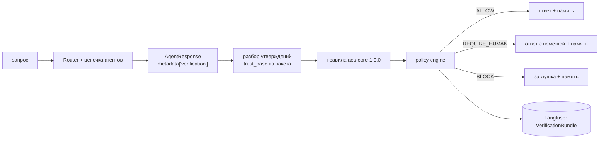

# Этап B. Методы формирования и проверки гипотез

Календарный этап 3 практики (октябрь – декабрь 2026). Отчётность — программная реализация и результаты промежуточного тестирования.

Этап состоит из трёх модулей; тесты пишутся вместе с кодом.

| Модуль | Требования | Код | Статус |
|---|---|---|---|
| B1. Генератор гипотез | 4, 5 | `atomic/diagnostics/features.py`, `generator.py` | ✅ |
| B2. Верификатор гипотез и аналоги | 6, 7 | `atomic/diagnostics/signatures.py`, `hypothesis_verifier.py`, `analogues.py`, `atomic/memory/bm25.py` | ✅ |
| B3. Верификатор ответа | 9 | `atomic/verification/` | ✅ |

---

## B3. Верификатор ответа

### Назначение

Детерминированный шлюз выпуска ответа оператору. Реализует цепочку из проекта 7-го семестра: **Claim → EvidenceRef → RulePack → PolicyDecision**. LLM может только структурировать ответ; решение «выпустить или нет» принимают правила.

### Место в конвейере

Верификатор — не ещё один агент в цепочке Chain of Responsibility, а пост-обработка `AgentResponse` между `_route_and_process()` и записью ответа в память.



### Контракт агента

Каждый агент кладёт в `AgentResponse.metadata["verification"]` список утверждений со ссылками:

```json
{"claims": [{"claim_id": "retriever-1", "text": "…",
             "evidence": [{"ref_id": "mem:1", "kind": "rag_chunk"}]}]}
```

| Агент | Утверждение | Вид источника | Чем разрешается ссылка |
|---|---|---|---|
| RetrieverAgent | ответ основан на найденных фрагментах | rag_chunk (`mem:<n>` или `atomic_documents:<id>`) | `VectorMemory.has_id` / `PgVectorStore.id_exists` |
| RetrieverAgent, фрагментов нет | ответ без опоры на базу знаний | model | — |
| CommandAgent | результат выполнения кода | tool_output (`exec:<хэш>`) | журнал запусков `CodeExecutor.runs` |
| AnalystAgent | рассуждение модели | model | — |

Для этого `VectorMemory` и `PgVectorStore` начали возвращать стабильный `id` фрагмента, а `CodeExecutor` — журналировать каждый запуск под собственным id.

### Правила пакета aes-core-1.0.0

Пакет — версионируемый файл `config/rulepacks/aes-core-1.0.0.toml`; любое изменение правил, порогов или весов доверия означает новую версию.

| Правило | Уровень | Проверка |
|---|---|---|
| EVIDENCE_REQUIRED | error | есть хотя бы одно утверждение, и у каждого утверждения есть хотя бы одна ссылка |
| NO_MODEL_ONLY | warning | нет утверждений, опирающихся только на текст модели |
| REF_RESOLVABLE | error | каждая ссылка (кроме текста модели) разрешается в существующий артефакт; вид без зарегистрированного разрешителя считается неразрешимым |

### Модель доверия и политика

Доверие к источнику (`trust_base`) назначает политика по виду источника (D-015):

| Вид источника | trust_base |
|---|---|
| подтверждение человека | 1,0 |
| нормативный документ | 0,95 |
| телеметрия (окно NPPAD) | 0,9 |
| вывод инструмента | 0,8 |
| фрагмент базы знаний | 0,7 |
| историческое событие | 0,6 |
| текст модели | 0,2 |

Сила утверждения = min trust_base его источников; уверенность ответа = min силы утверждений.

Решение политики:
1. нарушено хотя бы одно правило уровня error → **BLOCK**;
2. иначе нарушено правило уровня warning или уверенность ниже 0,5 → **REQUIRE_HUMAN**;
3. иначе → **ALLOW**.

`PolicyDecision` содержит решение, версию пакета, нарушенные правила, уверенность и машинные причины; вместе с утверждениями и результатами правил он образует `VerificationBundle`, который пишется в метаданные трассы Langfuse (основа требования 10).

### Режимы (D-014)

| Режим | Что происходит | Когда |
|---|---|---|
| off | проверки нет, поведение 6-го семестра | отладка, сравнение |
| shadow | решение вычисляется и пишется в трассу, текст не меняется | обычный чат (по умолчанию) |
| enforce | BLOCK → заглушка, REQUIRE_HUMAN → пометка с причинами; в память идёт только выпущенный текст | диагностический контур, демонстрация |

### Промежуточное тестирование

| Набор | Что проверяет | Тестов |
|---|---|---|
| `tests/unit/test_answer_verifier.py` | каждое правило на положительном и отрицательном примере; 7 сочетаний нарушений для policy engine; минимум по цепочке; загрузка и валидация пакета; блокировка ответа без `metadata["verification"]` и без ссылок; пропуск ответа с разрешимыми ссылками; запрет завышения доверия агентом; текст заглушки и пометки; сериализация | 23 |
| `tests/unit/test_workflow_verification.py` | встраивание в `AtomicWorkflow` с подменой LLM: режимы off/shadow/enforce, запись заглушки в память, `ask() -> str` | 9 |

Критерий готовности дорожной карты «верификатор ответа блокирует ответ без ссылок и пропускает ответ, все ссылки которого разрешаются» покрыт тестами `test_answer_without_refs_is_blocked`, `test_answer_without_verification_metadata_is_blocked` и `test_answer_with_resolvable_refs_is_allowed`.

**Живая проверка на моделях Ollama** (`test-results/2026-10-24-enforce-live.txt`, режим enforce):

| Запрос | Агент | Решение | Уверенность | Ссылка |
|---|---|---|---|---|
| «выполни код print(1+1)» | command | ALLOW | 0,80 | exec:… (запуск) |
| «найди информацию об atomic» | retriever | ALLOW | 0,70 | mem:1 (фрагмент) |
| «проанализируй архитектуру AI-агентов» | analyst | REQUIRE_HUMAN (NO_MODEL_ONLY) | 0,20 | только текст модели |

Регрессионные тесты базового ассистента в режиме shadow проходят без изменений.

### Ограничения

- Одно утверждение на ответ (D-016): проверяется существование источников, но не то, что LLM на них опирался.
- Пакет правил минимальный (три правила из проекта 7-го семестра). Правила на числовые диапазоны и конфликты источников, перечисленные в отчёте 6-го семестра, — кандидаты на версию 1.1.

---

## B1. Генератор гипотез

### Назначение

Этап 2 документа «Upgrade» (Soft Interpretation): по окну наблюдений сформировать несколько гипотез вида «вероятна ситуация X, уверенность Y» без рекомендаций действий. Защита от опасностей H3 (неверная классификация) и H4 (сверхуверенность): top-k гипотез вместо одной и калибровка уверенности.

### Вход и информационный барьер

Генератор принимает только `RestrictedWindow` — 12 точек (120 с) по 6 разрешённым каналам (PWNT, TAVG, PSGA, P, PRB, LVPZ, D-006), z-нормированных по train. Окно с другими каналами генератор отвергает. Модуль генератора не импортирует хранилище меток; метки получает только офлайн-скрипт обучения (`scripts/train_generator.py`), что проверяет статический контрактный тест.

### Метод

1. **Признаки** (`features.py`): для каждого канала — значение в начале и в конце окна, среднее, σ, минимум, максимум, наклон линейного тренда; 6 × 7 = 42 признака.
2. **Классификатор:** два кандидата — логистическая регрессия (со стандартизацией) и градиентный бустинг на гистограммах (300 итераций). Обучение на train-окнах 12 benchmark-классов (48 195 окон).
3. **Калибровка:** температурное масштабирование p ∝ exp(log p / T); T подбирается минимизацией log-loss на val (16 066 окон).
4. **Выбор модели:** минимальный log-loss на val после калибровки (D-019).
5. **Выход:** top-3 сценария с калиброванной уверенностью; сумма уверенностей ≤ 1 гарантируется типом `HypothesisSet`.

Модель сохраняется в `data/models/generator/` вместе с метаданными: версия (`gen-1.0.0-hgb-<хэш>`), коммит данных, хэш конфигурации данных, seed, метрики на val, матрица ошибок.

### Результаты на val

| Модель | top-1 | top-3 | NLL до → после | ECE до → после | T | обучение |
|---|---|---|---|---|---|---|
| логистическая регрессия | 0,652 | 0,977 | 0,769 → 0,761 | 0,057 → 0,050 | 0,84 | 11 с |
| **градиентный бустинг (выбран)** | **0,786** | **0,998** | 0,408 → 0,370 | 0,055 → **0,029** | 1,67 | 6 с |

T > 1 означает, что бустинг до калибровки был сверхуверен; калибровка вдвое снизила ошибку калибровки (ECE).

Основные пары путаницы генератора на 6 каналах (доля окон класса):

| Истинный класс | Верно | Путает с |
|---|---|---|
| LOCA (горячая нитка) | 0,46 | LOCAC 0,54 |
| LOCAC (холодная нитка) | 0,41 | LOCA 0,53, SLBIC 0,06 |
| SLBOC (паропровод вне оболочки) | 0,27 | MD 0,73 |
| MD (разбавление бора) | 0,78 | SLBOC 0,22 |
| SGBTR / SGATR | 0,90 / 0,94 | друг с другом 0,10 / 0,06 |
| RW / RI | 0,92 / 0,98 | друг с другом 0,08 / 0,02 |

Верный сценарий почти всегда попадает в top-3 (0,998). Поэтому основная задача верификатора — выбрать внутри top-3, а не искать сценарий заново. Неполнота шести каналов заложена намеренно (D-006).

### Тесты

`tests/unit/test_generator.py` (8 тестов): признаки и наклон; формат top-k, уверенность в [0, 1], сумма ≤ 1, ранги; обучаемость на синтетике; отказ на окне с чужими каналами; детерминизм при фиксированном seed; сохранение и загрузка; температура исправляет сверхуверенность; T = 1 не меняет вероятности. Плюс контрактные тесты барьера.

---

## B2. Верификатор гипотез и аналоги

### Назначение

Требования 6 и 7: независимо проверить каждую гипотезу по полному набору каналов, сформировать свидетельства «за» и «против» со ссылками на каналы и окна, подобрать аналоги из базы исторических событий — без предписания действий.

### Независимость от генератора

| | Генератор | Верификатор |
|---|---|---|
| Данные | 6 разрешённых каналов | 82 наблюдаемых канала (96 − 8 label_proxy − 7 постоянных; EBK в обеих группах) |
| Метод | обучаемый классификатор | квантильные сигнатуры и правила, без обучения весов |
| Выход | вероятности | свидетельства по каналам и статус |

### Сигнатуры сценариев (`signatures.py`, `scripts/train_verifier.py`)

По train-окнам для каждого сценария и каждого из 82 каналов считаются квантили q01, q05, q50, q95, q99 двух признаков окна: **уровня** (среднее z-значение) и **тренда** (наклон на шаг). Всего 164 признака. Типичный диапазон — [q05; q95], допустимый — [q01; q99].

Матрица специфичности spec[s, o, p] — доля окон сценария o, у которых признак p выходит за типичный диапазон сценария s. Построение занимает меньше секунды.

### Проверка гипотезы (`hypothesis_verifier.py`)

Для гипотезы s в окне:
1. **Конкуренты** — остальные гипотезы того же top-k (контрастная проверка, D-023).
2. **Вес признака** — средняя специфичность s против конкурентов. Берутся 15 признаков с наибольшим весом, вес ≥ 0,7.
3. **Свидетельство:** значение в типичном диапазоне s — «за» (вес w); вне допустимого — «против» (w); между ними — «против» (w/2).
4. **Доля подтверждений** = Σw(за) / Σw(все); ≥ 0,6 — подтверждена, ≤ 0,4 — отклонена, иначе — не определено. Если признаков с весом ≥ 0,7 нет, статус «не определено» с причиной.

Каждое свидетельство — `ChannelEvidence` со ссылкой `<window_id>#<канал>`, наблюдаемым значением, медианой сценария, весом и текстом, например: «Rad Monitor RB air (CPM): уровень −0,37σ — вне допустимого диапазона для LOCAC [+0,18; +5,52]».

### Подбор параметров (D-022)

Перебор 24 сочетаний на val (`test-results/2026-10-24-verifier-sweep-val.json`). Фрагмент:

| min_weight | признаков | порог | верные подтверждены | неверные подтверждены | top-1 после проверки | пробы: хоть одна подтверждена |
|---|---|---|---|---|---|---|
| 0,3 | 15 | 0,7 | 0,933 | 0,302 | 0,854 | 0,669 |
| 0,3 | 15 | 0,9 | 0,839 | 0,164 | 0,854 | 0,508 |
| 0,5 | 15 | 0,8 | 0,905 | 0,199 | 0,855 | 0,545 |
| **0,7** | **15** | **0,6** | **0,728** | **0,040** | **0,844** | 0,693 |
| 0,7 | 30 | 0,6 | 0,729 | 0,043 | 0,822 | 0,578 |

Критерий: максимум подтверждённых верных при ≤ 10 % подтверждённых неверных (ложное подтверждение опаснее неопределённости).

### Аналоги из базы ETHZ (`analogues.py`, `scripts/load_ethz.py`, `config/analogues.toml`)

1. **Подготовка:** из 1561 события оставлены 783 события на PWR-энергоблоках (D-020) → `data/processed/ethz/events.json` с хэшем источника.
2. **Поиск:** BM25 (`atomic/memory/bm25.py`, слова + биграммы) по описанию, системе-источнику и причине; запрос и системы-источники — из таблицы соответствия сценариев (D-021); ×1,5 при совпадении системы; порог 3,0; удаление дублей.
3. **Выход:** `EventAnalogue` с id `ethz:<номер>` (разрешается через `AnalogueFinder.has_event`) и формулировкой «В аналогичных случаях наблюдалось: …».

Примеры выдачи: SGATR → Indian Point 1988, McGuire 1989 (разрыв трубки ПГ); FLB → Loviisa 1993, Mihama 2004 (разрыв питательного трубопровода); LLB → события системы подпитки-продувки (Tsuruga 1996, Catawba 1986); MD → Philippsburg 2001, Chinon 1991 (концентрация бора).

### Промежуточная оценка на val (`test-results/2026-10-24-stage-b-val.json`)

16 066 окон val, 514 окон проб вне распределения. Test не использовался (D-025).

| Показатель | Значение |
|---|---|
| Генератор: top-1 / top-3 | 0,786 / 0,998 |
| Верные гипотезы: подтверждены / не определено / отклонены | 0,728 / 0,228 / 0,044 |
| Неверные гипотезы: отклонены / не определено / подтверждены | 0,741 / 0,218 / 0,040 |
| Top-1 гипотеза подтверждена и верна | 0,629 |
| Top-1 гипотеза подтверждена, но неверна | **0,010** |
| Top-1 после ранжирования по доле подтверждений | 0,844 |
| Свидетельства со ссылкой на канал и окно | 100 % |
| Свидетельств на гипотезу (среднее) | 6,7 |
| Пробы вне распределения: подтверждена хотя бы одна гипотеза / top-1 | 0,693 / 0,434 |
| Задержка на окно: генератор / верификатор / аналоги на сценарий | 18,5 / 0,28 / 1,7 мс |

По классам:

| Класс | Генератор top-1 | После проверки top-1 | Верная гипотеза подтверждена |
|---|---|---|---|
| FLB | 0,999 | 0,856 | 0,789 |
| LLB | 1,000 | 0,999 | 0,989 |
| LOCA | 0,465 | 0,420 | 0,000 |
| LOCAC | 0,411 | 0,383 | 0,002 |
| LR | 1,000 | 0,996 | 0,963 |
| MD | 0,780 | **1,000** | 1,000 |
| RI | 0,977 | 0,769 | 0,303 |
| RW | 0,924 | 0,902 | 0,412 |
| SGATR | 0,941 | 0,850 | 0,871 |
| SGBTR | 0,895 | 0,853 | 0,879 |
| SLBIC | 1,000 | 0,997 | 0,974 |
| SLBOC | 0,268 | **0,966** | 0,894 |

### Выводы промежуточного тестирования

1. **Верификатор резко снижает ложные подтверждения.** Без проверки оператор видел бы неверную top-1 гипотезу в 21 % окон; подтверждённой неверная top-1 гипотеза оказывается лишь в 1 % окон.
2. **Пару SLBOC ↔ MD верификатор разводит почти полностью** (top-1 0,27 → 0,97 и 0,78 → 1,00): по всем каналам разрыв паропровода и разбавление бора различаются, по шести — нет.
3. **Течь в горячей и холодной нитке на уровне окна не различается** ни генератором, ни верификатором: различающих признаков с весом ≥ 0,7 нет, обе гипотезы получают «не определено» с явной причиной. Это честный отказ вместо ложной уверенности; оператор видит, что это течь первого контура, но место не установлено.
4. **Ранжирование только по доле подтверждений хуже генератора на FLB, RI, RW**, где подтверждение держится на 1–2 свидетельствах. Итоговое правило выбора (сочетание уверенности генератора и статуса проверки) — задача этапа C.
5. **Пробы вне распределения подтверждаются слишком часто** (69 % окон): верификатор проверяет согласие с гипотезой, но не умеет сказать «ни один из известных сценариев». Нужна проверка новизны окна относительно всех сигнатур — задача этапа C.
6. **Производительность** достаточна для шага данных 10 с: весь контур укладывается в ≈ 20 мс на окно.

### Тесты

| Набор | Что проверяет | Тестов |
|---|---|---|
| `tests/unit/test_hypothesis_verifier.py` | признаки окна; верная гипотеза подтверждается, неверные отклоняются; свидетельства ссылаются на реальные каналы и окно; контрастные веса; неизвестный сценарий; окно не того набора гипотез; нет императивов; аналоги; сохранение сигнатур; сквозной путь на реальном окне val | 10 |
| `tests/unit/test_analogues.py` | релевантность, удаление дублей, пустой запрос, порог, формулировка и разрешимость id | 5 |
| `tests/unit/test_bm25.py` | токенизация, ранжирование, фразовые биграммы, поиск VectorMemory | 5 |

Иллюстрации для отчёта — `test-results/2026-10-24-demo-LOCA.txt`, `2026-10-24-demo-SGBTR.txt` (`scripts/demo_diagnosis.py`).

## Критерии готовности этапа B

| Критерий дорожной карты | Статус |
|---|---|
| У каждого модуля есть модульные тесты | ✅ генератор, верификатор гипотез, аналоги, BM25, верификатор ответа |
| Тест на утечку подтверждает барьер | ✅ `tests/contract/test_barrier.py` (включая модули генератора) |
| Верификатор ответа блокирует ответ без ссылок и пропускает ответ с разрешимыми ссылками | ✅ |

## Задачи, перенесённые на этап C

- Правило итогового выбора гипотезы и порог минимального числа свидетельств.
- Проверка новизны окна (ответ «ни один известный сценарий»).
- Передача пакета «гипотезы + свидетельства + аналоги» в AnalystAgent; утверждения со ссылками TELEMETRY и HISTORICAL_EVENT через верификатор ответа (разрешители: окна NPPAD, `AnalogueFinder.has_event`).
- Разметка релевантности аналогов для precision@k.
- Подключение `Variable_Power_Data` как внешнего стресс-теста.
- Итоговый benchmark на test.

---

## Обновление на этапе C

Результаты этого документа получены для 12 классов и без памяти о событии. На этапе C:
- MD исключён из обучаемых классов как класс без наблюдаемого события (D-034, [data-audit.md](data-audit.md));
- верификатор получил память о событии и попарный отбор признаков (D-030, D-038);
- добавлены проверка отклонения и новизны (D-032) и итоговое правило выбора (D-033).
Итоговые числа — в [stage-C-integration.md](stage-C-integration.md).
