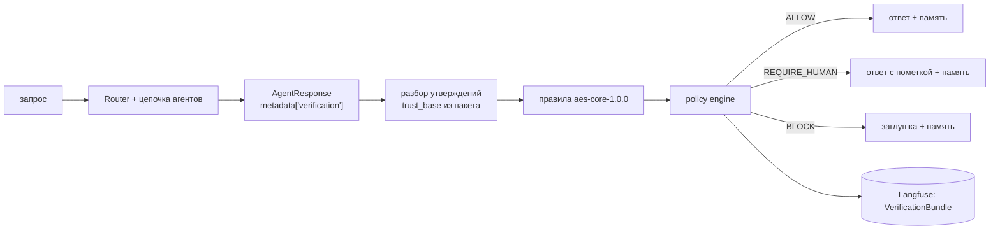

# Этап B. Методы формирования и проверки гипотез

Календарный этап 3 практики (октябрь – декабрь 2026). Отчётность — программная реализация и результаты промежуточного тестирования.

Этап состоит из трёх модулей; тесты пишутся вместе с кодом.

| Модуль | Требования | Код | Статус |
|---|---|---|---|
| B1. Генератор гипотез | 4, 5 | `atomic/diagnostics/features.py`, `generator.py` | в работе |
| B2. Верификатор гипотез и аналоги | 6, 7 | `atomic/diagnostics/signatures.py`, `hypothesis_verifier.py`, `analogues.py`, `atomic/memory/bm25.py` | в работе |
| B3. Верификатор ответа | 9 | `atomic/verification/` | ✅ |

---

## B3. Верификатор ответа

### Назначение

Детерминированный шлюз выпуска ответа оператору. Реализует цепочку из проекта 7-го семестра: **Claim → EvidenceRef → RulePack → PolicyDecision**. LLM может только структурировать ответ; решение «выпустить или нет» принимают правила.

### Место в конвейере

Верификатор — не ещё один агент в цепочке Chain of Responsibility, а пост-обработка `AgentResponse` между `_route_and_process()` и записью ответа в память.



### Контракт агента

Каждый агент кладёт в `AgentResponse.metadata["verification"]` список утверждений со ссылками:

```json
{"claims": [{"claim_id": "retriever-1", "text": "…",
             "evidence": [{"ref_id": "mem:1", "kind": "rag_chunk"}]}]}
```

| Агент | Утверждение | Вид источника | Чем разрешается ссылка |
|---|---|---|---|
| RetrieverAgent | ответ основан на найденных фрагментах | rag_chunk (`mem:<n>` или `atomic_documents:<id>`) | `VectorMemory.has_id` / `PgVectorStore.id_exists` |
| RetrieverAgent, фрагментов нет | ответ без опоры на базу знаний | model | — |
| CommandAgent | результат выполнения кода | tool_output (`exec:<хэш>`) | журнал запусков `CodeExecutor.runs` |
| AnalystAgent | рассуждение модели | model | — |

Для этого `VectorMemory` и `PgVectorStore` начали возвращать стабильный `id` фрагмента, а `CodeExecutor` — журналировать каждый запуск под собственным id.

### Правила пакета aes-core-1.0.0

Пакет — версионируемый файл `config/rulepacks/aes-core-1.0.0.toml`; любое изменение правил, порогов или весов доверия означает новую версию.

| Правило | Уровень | Проверка |
|---|---|---|
| EVIDENCE_REQUIRED | error | есть хотя бы одно утверждение, и у каждого утверждения есть хотя бы одна ссылка |
| NO_MODEL_ONLY | warning | нет утверждений, опирающихся только на текст модели |
| REF_RESOLVABLE | error | каждая ссылка (кроме текста модели) разрешается в существующий артефакт; вид без зарегистрированного разрешителя считается неразрешимым |

### Модель доверия и политика

Доверие к источнику (`trust_base`) назначает политика по виду источника (D-015):

| Вид источника | trust_base |
|---|---|
| подтверждение человека | 1,0 |
| нормативный документ | 0,95 |
| телеметрия (окно NPPAD) | 0,9 |
| вывод инструмента | 0,8 |
| фрагмент базы знаний | 0,7 |
| историческое событие | 0,6 |
| текст модели | 0,2 |

Сила утверждения = min trust_base его источников; уверенность ответа = min силы утверждений.

Решение политики:
1. нарушено хотя бы одно правило уровня error → **BLOCK**;
2. иначе нарушено правило уровня warning или уверенность ниже 0,5 → **REQUIRE_HUMAN**;
3. иначе → **ALLOW**.

`PolicyDecision` содержит решение, версию пакета, нарушенные правила, уверенность и машинные причины; вместе с утверждениями и результатами правил он образует `VerificationBundle`, который пишется в метаданные трассы Langfuse (основа требования 10).

### Режимы (D-014)

| Режим | Что происходит | Когда |
|---|---|---|
| off | проверки нет, поведение 6-го семестра | отладка, сравнение |
| shadow | решение вычисляется и пишется в трассу, текст не меняется | обычный чат (по умолчанию) |
| enforce | BLOCK → заглушка, REQUIRE_HUMAN → пометка с причинами; в память идёт только выпущенный текст | диагностический контур, демонстрация |

### Промежуточное тестирование

| Набор | Что проверяет | Тестов |
|---|---|---|
| `tests/unit/test_answer_verifier.py` | каждое правило на положительном и отрицательном примере; 7 сочетаний нарушений для policy engine; минимум по цепочке; загрузка и валидация пакета; блокировка ответа без `metadata["verification"]` и без ссылок; пропуск ответа с разрешимыми ссылками; запрет завышения доверия агентом; текст заглушки и пометки; сериализация | 23 |
| `tests/unit/test_workflow_verification.py` | встраивание в `AtomicWorkflow` с подменой LLM: режимы off/shadow/enforce, запись заглушки в память, `ask() -> str` | 9 |

Критерий готовности дорожной карты «верификатор ответа блокирует ответ без ссылок и пропускает ответ, все ссылки которого разрешаются» покрыт тестами `test_answer_without_refs_is_blocked`, `test_answer_without_verification_metadata_is_blocked` и `test_answer_with_resolvable_refs_is_allowed`.

**Живая проверка на моделях Ollama** (`test-results/2026-10-24-enforce-live.txt`, режим enforce):

| Запрос | Агент | Решение | Уверенность | Ссылка |
|---|---|---|---|---|
| «выполни код print(1+1)» | command | ALLOW | 0,80 | exec:… (запуск) |
| «найди информацию об atomic» | retriever | ALLOW | 0,70 | mem:1 (фрагмент) |
| «проанализируй архитектуру AI-агентов» | analyst | REQUIRE_HUMAN (NO_MODEL_ONLY) | 0,20 | только текст модели |

Регрессионные тесты базового ассистента в режиме shadow проходят без изменений.

### Ограничения

- Одно утверждение на ответ (D-016): проверяется существование источников, но не то, что LLM на них опирался.
- Пакет правил минимальный (три правила из проекта 7-го семестра). Правила на числовые диапазоны и конфликты источников, перечисленные в отчёте 6-го семестра, — кандидаты на версию 1.1.
