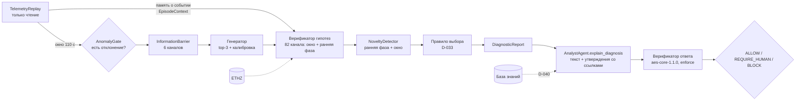

# Этап C. Интеграция и эксперименты

Этап C дорожной карты (декабрь 2026; выполнен 24–25.10.2026): передача гипотез в конвейер ассистента (требование 8), трассировка (10), сквозные тесты и benchmark (11, 12), воспроизводимость (13). Отчётность этапа — «результаты экспериментов и количественные показатели».

Кроме пунктов дорожной карты на этапе C закрыты три вопроса, поставленные по итогам этапа B:
- различение течи в горячей (LOCA) и холодной (LOCAC) нитке;
- слишком частое подтверждение сценариев вне обучающего набора: нужна проверка новизны;
- классы NPPAD с единственным прогоном (аудит данных, [data-audit.md](data-audit.md)).

Связанные решения: D-027 … D-041 в [decisions.md](decisions.md).

---

## 1. Архитектура диагностического контура

Точка входа — `AtomicWorkflow.diagnose(source, t, use_llm=False)` (`atomic/orchestration/workflow.py`) и HTTP `POST /diagnose {run_id, t, explain, session_id}` (`atomic/api/server.py`). Конвейер — `atomic/diagnostics/pipeline.py`.

### 1.1. Память о событии (D-030)

Одно окно (110 с) не различает LOCA и LOCAC: top-1 по окну 0,54. Различие есть в первые 30–120 с после начала события. Поэтому верификатор получает `EpisodeContext`:
- исходное состояние;
- до 120 с от начала события, только уже наблюдённые точки (причинно).

По нему считаются признаки ранней фазы `d30/d60/d120` — изменение каждого канала через 30, 60 и 120 с. Признаки, которые ещё не наблюдались, равны NaN и в сравнении не участвуют.

Проверка на уровне прогона: признаки ранней фазы различают LOCA и LOCAC с точностью 1,0. Результат сохраняется при шуме 5 % и после исключения 8 самых информативных каналов. Значит, различие физическое, а не артефакт отдельного канала.

### 1.2. Попарный отбор признаков (D-038)

С памятью о событии гипотеза проверяется против каждого конкурента из top-k по своим признакам: на каждого конкурента берутся `top_n / |O|` признаков с наибольшей специфичностью именно против него. Без памяти используется прежний средний отбор (D-031), потому что попарный без памяти подтверждал 25 % неверных гипотез на val.

### 1.3. Проверка отклонения и новизны (D-032)

Верификатор гипотез сам не может ответить на два вопроса, поэтому они вынесены в отдельные проверки.

1. **Есть ли отклонение** (`AnomalyGate`). Хотя бы один наблюдаемый канал отличается от исходного состояния больше чем на 1 %. Четыре канала дрейфуют и без события (HTR, RBLK, RHFL, RHMT); они не учитываются. Пороги заданы по прогонам без события: ATWS, SP, MD.
2. **Похоже ли событие на известные** (`NoveltyDetector`):
   - RMS-расстояние до ближайшего train-события по признакам ранней фазы (робастная нормировка, только наблюдённые признаки);
   - расстояние до ближайшего train-окна.

   Пороги — 99-й перцентиль на val (событие 1,312; окно 6,093). Это даёт 2,0 % ложных тревог на val и 1,4 % на test.

### 1.4. Итоговое правило выбора (D-033)

| Условие | Исход | Решение верификатора ответа |
|---|---|---|
| отклонения нет | NO_ANOMALY | ALLOW |
| событие новое | NOVEL | REQUIRE_HUMAN |
| ни одной подтверждённой гипотезы | UNCONFIRMED | REQUIRE_HUMAN |
| одна подтверждённая или лидер опережает вторую на ≥ 0,1 | IDENTIFIED | ALLOW |
| иначе | AMBIGUOUS | REQUIRE_HUMAN |

Система только интерпретирует данные. Рекомендации действий не формируются; это проверяет правило NO_DIRECTIVES.

### 1.5. Ответ AnalystAgent и верификатор ответа (D-035, D-036, D-040)

`explain_diagnosis` строит ответ в две части.
- **Детерминированная.** Строится только из `DiagnosticReport`:
  - оценка ситуации;
  - гипотезы со статусами проверки;
  - свидетельства [E1…] со ссылками `<окно>#<канал>`;
  - аналоги ETHZ [A1…];
  - для установленного сценария — фрагменты базы знаний [D1…].

  Каждое утверждение несёт ссылки (TELEMETRY, HISTORICAL_EVENT или RAG_CHUNK).
- **Необязательное пояснение LLM** (`use_llm=True`). Разбирается по предложениям:
  - предложение без ссылок опирается только на модель, и ответ уходит на оценку человеком;
  - ссылка на несуществующее свидетельство блокирует пояснение (REF_RESOLVABLE); тогда выпускается детерминированный ответ с пометкой (D-041).

Пакет правил `aes-core-1.1.0` (`config/rulepacks/`) — это три правила этапа B и два новых:
- DIAGNOSIS_CONFIRMED (warning): выпустить ответ без оговорки можно только при исходе IDENTIFIED или NO_ANOMALY;
- NO_DIRECTIVES (error): указания к действию запрещены.

Диагностический ответ всегда проверяется в режиме `enforce` (D-014). Разрешители ссылок: `TelemetryReplay.resolves`, `AnalogueFinder.has_event`, `has_id` векторной памяти.

### 1.6. Трассировка (требование 10)

`diagnose` пишет в Langfuse трассу `atomic.diagnose` со спанами:
- `diagnostics.hypotheses` — версия генератора;
- `diagnostics.verification` — версия верификатора, флаг памяти;
- `diagnostics.novelty`;
- `diagnostics.documents`.

В метаданные трассы попадают:
- полный `VerificationBundle`: утверждения, результаты правил, решение, версия пакета;
- исход, версии моделей, задержки этапов, `window_id`.

По трассе восстанавливается путь «данные → гипотеза → проверка → ответ → решение». В тестах ключи Langfuse обнуляются (D-018); с `ATOMIC_TEST_LANGFUSE=1` трассы отправляются.

### 1.7. Источники данных только для чтения

- `TelemetryReplay` (`atomic/diagnostics/telemetry.py`) воспроизводит прогон NPPAD. Он выдаёт окно на момент t и память о событии (только прошлое) и разрешает ссылки.
- `variable_power.py` читает 12 прогонов Variable_Power (`scripts/convert_variable_power.py`, `.mdb` → CSV). Это внешний стресс-тест, в обучение не входит (D-029). Начало события определяется причинно, по последней стационарной точке (D-039).

---

## 2. Данные и база событий

### 2.1. Аудит классов NPPAD (D-034, [data-audit.md](data-audit.md))

«Один прогон» означает: у шести классов NPPAD (ATWS, LACP, LOF, Normal, SP, TT) нет параметра тяжести, и в наборе есть ровно одна симуляция. На Figshare лежат те же данные; новые прогоны можно получить только в PCTRAN.

Аудит показал:
- MD совпадает с прогоном без события;
- ATWS и SP не отличаются от стационара;
- Normal — переходный процесс;
- SLBOC отличается от стационара только по мониторам радиации.

Итог:
- обучаемых классов 11;
- ATWS, MD, SP — пробы «без события» (ожидается NO_ANOMALY);
- LACP, LOF, Normal, TT — пробы «вне области» (ожидается NOVEL).

Аугментацию не применяли, чтобы не выдавать синтетику за данные.

### 2.2. ETHZ (D-027, D-028)

`ETHZ_Database_Access_tool.xlsm` — VBA-интерфейс к `Support_file.xlsx`. Макросы разобраны (olevba), фильтрация воспроизведена в `scripts/load_ethz.py`. Добавлено поле Initiating Event (канонизированное).

Аналоги ищутся в два уровня: структурное совпадение по исходному событию, затем BM25 по описанию. Качество на размеченной выборке (`test-results/2026-10-24-analogues-eval.json`): precision@3 0,643 только по тексту, 0,936 с учётом исходного события.

---

## 3. Benchmark

Офлайн-оценщик `scripts/benchmark.py` — единственный компонент, который видит метки. Разбиение по прогонам 60/20/20, seed 42 (D-012). Параметры подбирались только на val (`scripts/sweep_verifier.py`, критерий безопасности D-022).

| Прогон | Файл | Что изменено |
|---|---|---|
| v1 | `test-results/2026-10-25-benchmark-test-v1-mean.json` | средний отбор признаков |
| итоговый | `test-results/2026-10-25-benchmark-test.json` | попарный отбор (D-038), причинное начало события на Variable_Power (D-039) |

**Методологическая оговорка.** Слабость LOCA (v1) и ложная идентификация на Variable_Power (промежуточный прогон) замечены на test и на стресс-тесте. Исправления разработаны и настроены на val. Поэтому итоговый test не полностью «нетронутый», и в отчёте приводятся оба прогона. Финальные числа ВКР будут получены на этапе E на замороженной версии.

Паспорт итогового прогона:
- generator `gen-1.0.0-hgb-1a0fecad01`;
- verifier `hv-1.2.0-pairwise | sig-1.0.0-affd161cd6`;
- novelty `nov-1.0.0-5208735f8e`;
- rulepack `aes-core-1.1.0`;
- NPPAD `a8d54ed0`;
- data fingerprint `d8676aaf07a1ac3b`, config `857d23df39daddc5`;
- uv.lock `fe60eb17db26005a`;
- Python 3.12.12, scikit-learn 1.9.1.

Test: 13 984 окна, 222 прогона, 11 классов.

### 3.1. Генерация гипотез (6 каналов)

| Метрика | test |
|---|---|
| top-1 | 0,888 |
| верный сценарий в top-3 | 0,996 |
| ECE до / после температурной калибровки | 0,048 / 0,028 |
| NLL после калибровки | 0,221 |

### 3.2. Проверка гипотез (82 канала)

| Метрика | v1, с памятью | итог, с памятью | без памяти |
|---|---|---|---|
| верных гипотез подтверждено | 0,947 | **0,969** | 0,687 |
| неверных гипотез подтверждено | 0,050 | **0,015** | 0,041 |
| top-1 после проверки | 0,978 | **0,994** | 0,847 |

Все свидетельства ссылаются на конкретный канал и окно: `ChannelEvidence.ref_id = <окно>#<канал>` обязателен по контракту. В 560 выборочных ответах ни одна ссылка не оказалась неразрешимой.

### 3.3. Итоговые исходы на test

| Метрика | v1 | итог | без памяти |
|---|---|---|---|
| IDENTIFIED (покрытие) | 0,888 | **0,952** | 0,623 |
| точность IDENTIFIED | 0,9985 | **0,9989** | 0,985 |
| неверных IDENTIFIED от всех окон | 0,0014 | **0,0010** | 0,0091 |
| AMBIGUOUS | — | 0,003 | 0,066 |
| UNCONFIRMED | — | 0,031 | 0,297 |
| NOVEL (ложная тревога новизны) | 0,014 | 0,014 | 0,014 |

По классам в итоговом прогоне (доля IDENTIFIED, точность 1,0 у всех классов): FLB 0,98, LLB 0,99, **LOCA 0,96 (v1: 0,46, неоднозначно 0,50)**, LOCAC 0,96, LR 0,90, RI 0,93, RW 0,88, SGATR 0,98, SGBTR 0,99, SLBIC 0,89, SLBOC 0,96.

### 3.4. Пробы вне обучающего набора

| Проба | Группа | Окон | Ожидается | Как ожидалось | Ошибочно IDENTIFIED |
|---|---|---|---|---|---|
| ATWS | без события | 95 | NO_ANOMALY | 1,00 | 0 |
| MD | без события | 9697 | NO_ANOMALY | 1,00 | 0 |
| SP | без события | 84 | NO_ANOMALY | 1,00 | 0 |
| LACP | вне области | 83 | NOVEL | 1,00 | 0 |
| LOF | вне области | 84 | NOVEL | 1,00 | 0 |
| Normal | вне области | 49 | NOVEL | 1,00 | 0 |
| TT | вне области | 119 | NOVEL | 1,00 | 0 |

На этапе B пробы подтверждались в 69 % окон. Теперь подтверждений 0.

**Предел проверки новизны** (`test-results/2026-10-25-novelty-loco-val.json`). В схеме «исключить один класс» класс убирается из эталона детектора, после чего проверяется, распознаётся ли он как новый.
- В среднем так распознаётся 43 % окон при 1,4 % ложных тревог на остальных классах.
- Хорошо отделяются LLB, LR, RI, SLBIC (89–100 %).
- Почти не отделяются LOCA/LOCAC (друг через друга), RW, SGATR, SLBOC (0–12 %).

Сценарий, физически похожий на известный, принципиально неотличим от него. Это ограничение метода, а не настройки.

### 3.5. Внешний стресс-тест: изменение мощности (Variable_Power)

12 прогонов: 4 нормальных изменения мощности 70–100 % и 8 аварий на фоне изменения мощности. Всего 296 окон до ввода неисправности и 320 после.

| Метрика | оракульное начало | причинное начало (D-039) |
|---|---|---|
| ложные IDENTIFIED до ввода неисправности | 0,037 (NORM_100_to_80: 0,18 — «LR») | **0** |
| неверные IDENTIFIED после ввода | 0,003 | **0** |
| верные IDENTIFIED после ввода | 0 | 0 |

Нормальные изменения мощности и аварии на их фоне получают исход NOVEL: такого режима нет в обучающих данных NPPAD (все прогоны начинаются со 100 % мощности). Система честно сообщает, что ситуация незнакома, а не угадывает. На всех 222 test-прогонах NPPAD причинный детектор начала совпадает с принятым началом t = 0.

### 3.6. Верификатор ответа

| Метрика | Значение |
|---|---|
| ответов (каждое 25-е окно test) | 560 |
| ALLOW / REQUIRE_HUMAN / BLOCK | 0,952 / 0,048 / 0 |
| REQUIRE_HUMAN по исходам | UNCONFIRMED 19, NOVEL 7, AMBIGUOUS 1 |
| испорченные ответы: без ссылок / ссылка в никуда / указание к действию | 560 / 560 / 560, все BLOCK |
| испорченных ответов выпущено как ALLOW | **0** |

### 3.7. Пояснения LLM

`scripts/eval_llm_narrative.py`, Ollama `qwen2.5-7B-instruct` (Q4_K_M): по одному test-окну каждого из 11 классов и пробы TT, MD; `diagnose(use_llm=True)`.

| Метрика | прогон 1 (до D-041) | прогон 2 (с откатом D-041) |
|---|---|---|
| случаев | 13 | 13 |
| предложений со ссылками [E/A/D] | 37 из 47 (0,79) | 39 из 43 (0,91) |
| ссылок на несуществующие свидетельства | 3 | 1 |
| ALLOW / REQUIRE_HUMAN / BLOCK | 4 / 7 / 2 | 11 / 2 / 0 |
| пояснений отброшено (откат к детерминированному ответу) | — | 1 (MD: REF_RESOLVABLE, NO_MODEL_ONLY) |
| время ответа LLM, с | 7–46 | 10–51 |

Файлы: `test-results/2026-10-25-llm-narrative-run1.txt`, `test-results/2026-10-25-llm-narrative.json`.

Выводы:
- Верификатор ответа ловит характерные ошибки LLM: ссылку на несуществующее свидетельство (BLOCK) и утверждение без опоры (REQUIRE_HUMAN). Указаний к действию модель не дала ни разу.
- В прогоне 1 из-за двух ошибочных пояснений терялась корректная детерминированная диагностика. Поэтому введён откат (D-041).
- Ответ LLM недетерминирован: при temperature 0,2 и том же входе доля ALLOW менялась с 4 до 11 из 13. Воспроизводима только детерминированная часть ответа; разброс пояснений учитывается при оценке.
- Время ответа LLM (десятки секунд) на три порядка больше времени контура (26 мс). Поэтому пояснение необязательно и по умолчанию выключено.

### 3.8. Задержка (300 окон, без LLM)

| Этап | p50, мс | p95, мс |
|---|---|---|
| генератор | 18,5 | 26,7 |
| верификатор гипотез | 4,5 | 5,5 |
| проверка новизны | 3,1 | 3,6 |
| весь контур с аналогами | 26,3 | 34,1 |

Шаг данных NPPAD — 10 с, поэтому контур работает с запасом более чем в 290 раз. Узкое место отчёта 6-го семестра — время ответа LLM; оно касается только необязательного пояснения.

### 3.9. Воспроизводимость

`benchmark.py --repeat` выполняет оценку дважды на одной версии: метрики совпали полностью (`identical_metrics_on_repeat: true`). Воспроизводимость обеспечивают:
- `uv.lock`;
- конфигурации `config/*.toml` (с хэшами в паспорте);
- seed 42;
- коммит источника NPPAD в манифесте;
- версии моделей в паспорте.

Модель Ollama фиксируется в `test-results/*llm*` (поле `model`); пояснения LLM недетерминированы (раздел 3.7).

---

## 4. Тесты

`uv run pytest -m "not slow and not llm"` — модульные, контрактные и сквозные тесты без LLM и БД. Новое на этапе C:
- `test_onset.py` — признаки ранней фазы, причинность, NaN;
- `test_novelty.py` — проверка отклонения, детектор новизны, сохранение и загрузка;
- `test_diagnosis_answer.py`:
  - правило выбора на всех исходах;
  - текст ответа;
  - разбор пояснения LLM;
  - правила aes-core-1.1.0;
  - решения верификатора на подменённых ответах LLM;
  - ссылки на базу знаний;
- `test_diagnose_e2e.py` — сквозной сценарий «окно NPPAD → гипотезы → проверка → ответ AnalystAgent → PolicyDecision» на реальных моделях и val-окнах, `TelemetryReplay`, Variable_Power и причинное начало события, аналоги по исходному событию.

Итог прогона — `test-results/2026-10-25-stage-c.txt`.

---

## 5. Ограничения

1. **Рабочая точка.** Обучающие данные — только сценарии со 100 % мощности. При другой мощности система отвечает NOVEL, а не диагнозом (раздел 3.5).
2. **Похожие сценарии.** Проверка новизны не отличает новый сценарий от физически близкого известного (раздел 3.4).
3. **SLBOC** отличается от стационара только по мониторам радиации. Сигнатура держится на них, и при отказе этих датчиков класс неразличим.
4. **Новое стационарное состояние** сбрасывает событие на стресс-тесте (D-039). Политика «защёлкивания» события — этап E.
5. **База знаний** не содержит документов по аварийным сценариям. Механизм ссылок [D…] готов (D-040), наполнение — этап E.
6. **Test-выборка** использовалась для диагностики двух проблем (раздел 3). Финальные числа — на этапе E.
7. **LLM-as-a-Judge** для качества текста пояснений (вспомогательная оценка, на выпуск ответа не влияет) не реализован. Пока измеряются доля предложений со ссылками и решения верификатора (раздел 3.7).

---

## 6. Критерии готовности этапа C

| Критерий дорожной карты | Статус |
|---|---|
| Пакет «гипотезы + свидетельства + аналоги» передаётся AnalystAgent, объяснение со ссылками, итог проходит верификатор ответа | ✅ `explain_diagnosis`, `diagnose` (enforce); ссылки на документацию — механизм есть, база знаний пуста (D-040) |
| VerificationBundle каждого запроса в Langfuse: запрос, утверждения, правила, решение, версия пакета | ✅ трасса `atomic.diagnose` и спаны этапов |
| Сквозной сценарий от окна NPPAD до ALLOW / REQUIRE_HUMAN / BLOCK выполняется автоматически | ✅ `test_diagnose_e2e.py`, `benchmark.py`, `POST /diagnose` |
| Повторный прогон даёт те же детерминированные результаты | ✅ `identical_metrics_on_repeat: true` |
| Метрики benchmark: генерация, проверка гипотез, проверка ответа, поиск, производительность, воспроизводимость | ✅ разделы 3.1–3.9; recall@k для аналогов не считался (нет полной разметки релевантных событий) |
